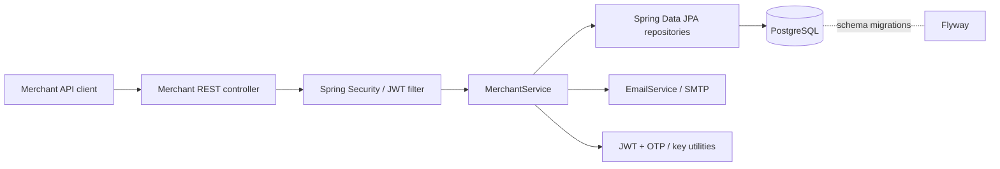

# Pipegate


**Pipegate is an in-development Java/Spring Boot payment-integration middleware project.** Its goal is to give merchants a consistent API for payment collection, disbursement and account monitoring across different providers, while centralizing authentication, transaction tracking, webhooks and reconciliation.

**Current scope:** merchant onboarding and account access. **Provider integrations and actual payment processing are not implemented in the current repository.** This is a learning/portfolio project, **not a production payment platform**. Do not use it for real funds or customer data.

## Why build it?

Integrating several payment providers can mean handling different request formats, authentication schemes, asynchronous callbacks and transaction states. Pipegate aims to isolate those differences behind a merchant-facing API, making provider-specific integrations and operational concerns easier to manage in one place.

That is the **design goal**, not a claim that the unified integration layer is already working.

## Development status

| Capability | Status | What is in the code |
| --- | --- | --- |
| Merchant registration | **Implemented in code** | Business details, BCrypt password hash, generated merchant code, selected service records and pending-verification status |
| Email OTP onboarding | **Implemented in code** | Six-digit OTP, SHA-256 hash storage, expiry check and SMTP email integration through Spring Mail |
| Merchant activation | **Implemented in code** | Verify OTP, activate merchant, generate sandbox API/secret keys and return the secret once in the response |
| Authentication | **Implemented in code** | JWT access token on login, hashed refresh-token storage, refresh endpoint and logout that revokes refresh tokens |
| Service access requests | **Implemented in code** | Additional service requests recorded as pending approval |
| Live upgrade application | **Implemented in code** | Collect business verification details and set the merchant to pending live approval; **no live activation workflow** |
| PostgreSQL migrations | **Present** | Flyway migrations for merchants, merchant services, OTP verifications and refresh tokens |
| API discovery | **Configured** | Springdoc/Swagger UI configuration for the existing merchant endpoints |
| Provider adapters | **Planned** | No working payment-provider client; current placeholder is empty |
| Collections, disbursements and account monitoring | **Planned** | Service type enums exist; transaction APIs and provider processing do not |
| Webhooks, reconciliation and idempotency | **Planned** | No implemented end-to-end workflows yet |

“Implemented in code” means the corresponding controller/service logic exists, **not** that it is production-hardened or comprehensively tested. Some security issues are listed under [Limitations and security priorities](#limitations-and-security-priorities).

## Tech stack

- **Backend:** Java 17, Spring Boot 3.5.13, Spring Web, Spring Security, Spring Validation
- **Data:** Spring Data JPA, PostgreSQL, Flyway migrations
- **Authentication:** BCrypt, JJWT for signed access tokens, SHA-256–hashed refresh tokens
- **Email:** Spring Mail / configurable SMTP for onboarding messages
- **Documentation:** Springdoc OpenAPI / Swagger UI
- **Testing:** JUnit/Spring Boot Test dependencies; currently a basic context-load test
- **Build:** Maven (Maven Wrapper included)

## Current architecture

The diagram shows what is present today, not a completed payment-processing architecture.



Relevant code:

- `merchant/controller/MerchantController.java` — current HTTP endpoints
- `merchant/service/MerchantService.java` — registration, verification, auth and request workflows
- `security/JwtAuthenticationFilter.java` and `config/SecurityConfig.java` — JWT authentication and route policy
- `merchant/domain/` and `merchant/repository/` — merchant entities and persistence
- `common/util/` — OTP, JWT and key-generation utilities
- `src/main/resources/db/migration/` — versioned SQL migrations

## Getting started (local development)

**Prerequisites:** Java 17+, PostgreSQL, Maven or the included Maven Wrapper, and access to an SMTP test inbox/server if you want to exercise emailed OTPs.

1. Clone the repository:

   ```bash
   git clone https://github.com/SirOlash/Pipegate.git
   cd Pipegate
   ```

2. Create a local PostgreSQL database named `pipegate_db` (or change the JDBC URL to your own local database).

3. Copy `src/main/resources/application-example.yml` to a **local, untracked** `src/main/resources/application.yml`. Replace the sample database and SMTP credentials with your own development values.

4. The example file does **not yet include** required JWT configuration. Add the following nested properties under the existing `pipegate:` section:

   ```yaml
   jwt:
     secret: YOUR_PRIVATE_RANDOM_HEX_KEY
     access-token-expiry-minutes: 15
     refresh-token-expiry-days: 30
   ```

   Generate `secret` as a **random 32-byte (64-hex-character) value or longer**; `JwtUtil` parses it as hex. This secret must remain private and must **never be committed**. The repository's `.gitignore` already excludes `application.yml`; still check `git status` before committing changes.

5. Start the application:

   ```bash
   ./mvnw spring-boot:run
   ```

   On Windows PowerShell, use `.\mvnw.cmd spring-boot:run`. Flyway is enabled in the sample configuration and applies the current migrations to the configured PostgreSQL database.

**Configuration notes:** The example YAML contains placeholders, not working credentials. Registration calls the configured SMTP sender; an unavailable SMTP test server can prevent the onboarding flow from completing. The checked-in `application-example.yml` is a starting point, **not** a ready-to-run secure configuration. Do not use actual merchant identities or banking information for local tests.

### API documentation

When the application starts with Springdoc available, try:

- Swagger UI: `http://localhost:8080/swagger-ui/index.html`
- OpenAPI JSON: `http://localhost:8080/v3/api-docs`

These document the **current** endpoints, not the planned payment APIs.

## Current API endpoints

Base path: `/api/v1/merchants`.

| Method | Path | Current behavior |
| --- | --- | --- |
| POST | `/register` | Create a merchant in `SANDBOX` mode, record requested services and email an OTP |
| POST | `/verify-email` | Validate OTP, activate the merchant and issue sandbox API/secret keys |
| POST | `/login` | Authenticate merchant and return a JWT access token and refresh token |
| POST | `/auth/refresh` | Validate stored refresh token and issue a new access token |
| POST | `/auth/logout` | Revoke the merchant's stored refresh tokens |
| POST | `/services/request` | Record an additional service request as `PENDING_APPROVAL` |
| POST | `/upgrade/live` | Submit business details for live-mode review; does not enable live payments |

All routes above except `/auth/logout`, `/services/request` and `/upgrade/live` are permitted without an access token by the current security configuration. Protected routes require `Authorization: Bearer <JWT>`. The two request endpoints additionally expect `X-Merchant-Id`; this **must be bound to the authenticated merchant before public exposure** (see security priorities).

### Example: register a test merchant

```http
POST /api/v1/merchants/register
Content-Type: application/json

{
  "businessName": "Demo Merchant",
  "email": "demo@example.invalid",
  "password": "change-this-local-demo-password",
  "phoneNumber": "08012345678",
  "requestedServices": ["PAYMENT_COLLECTION"],
  "webhookUrl": "https://example.invalid/webhook"
}
```

The API records the merchant as `PENDING_VERIFICATION` and attempts to send a six-digit OTP. Check the SMTP test inbox, then send the OTP to `POST /api/v1/merchants/verify-email`:

```json
{
  "email": "demo@example.invalid",
  "otp": "123456"
}
```

**The OTP shown is only an illustrative placeholder**, not a valid value. A successful activation response includes the sandbox API key and a **one-time secret**; handle them like credentials and never publish them in logs, screenshots or commits.

You can then call `POST /login` with the email/password used at registration. This returns a JWT bearer access token and refresh token. The current implementation revokes stored refresh tokens at logout; **already-issued JWTs are not immediately invalidated and remain usable until they expire**.

### Service types

- `PAYMENT_COLLECTION`
- `PAYMENT_DISBURSEMENT`
- `ACCOUNT_MONITORING`

These represent **merchant-selected capabilities**, not proof that their payment operations are available. Registration currently marks initially requested service records `ACTIVE` in the database, but there are no working transaction/provider operations behind those flags.

## Testing

```bash
./mvnw test
```

PowerShell: `.\mvnw.cmd test`.

The committed test folder currently contains `PipegateApplicationTests` with a Spring context-loading test. There is **no comprehensive test suite for merchant registration, permissions, authentication or payment workflows yet**. Automated tests and runtime operation have **not been independently verified as part of this README update**.

## Roadmap

A practical, incremental plan—features are **not implemented** unless moved to the status table above:

1. **Harden merchant onboarding:** authenticate merchant-scoped changes using the JWT principal, fix credential issuance details, validate OTP abuse controls and add focused integration/security tests.
2. **Build provider adapter contracts:** normalize provider-specific requests/responses for collection and disbursement.
3. **Introduce transaction lifecycle:** persistent transaction records, statuses, provider references and safe query behavior.
4. **Add reliable webhook handling:** signature verification, duplicate-event protection, idempotent updates and asynchronous processing.
5. **Reconciliation and operations:** compare provider events against internal records; add retries, audit trails, metrics and failure recovery.
6. **Developer experience:** complete integration tests, a safe mock/sandbox adapter, example requests, and deployment documentation.

## Limitations and security priorities

**Do not deploy this branch as an internet-facing payment system.** The project is still evolving.

- **Merchant authorization:** `/services/request` and `/upgrade/live` look up merchants using the client-supplied `X-Merchant-Id` rather than the authenticated principal. Access to another merchant's records must be prevented by binding these operations to the caller's identity.
- **JWT lifecycle:** logging out revokes refresh tokens but does not invalidate existing access JWTs immediately.
- **Credentials:** secret-key generation currently uses the public-key prefix for both keys; API key storage, exposure and rotation policies need security review before public use.
- **OTP security:** six-digit OTPs are stored as unsalted SHA-256 hashes without implemented attempt throttling; rate limits and stronger verification controls are needed.
- **Live access:** upgrade requests only set `PENDING_LIVE_APPROVAL`; there is no review/approval pipeline or live provider switch.
- **Payments:** no working provider adapters, collections, disbursements, webhooks, transaction reconciliation or monetary ledger.
- **Email and startup configuration:** SMTP must be configured, and the example YAML lacks the required JWT values. Avoid committing real credentials.
- **Tests and deployment:** only a context-load test exists in `main`, and no live deployment is claimed here.

These are development priorities, not security guarantees.

## License

MIT — see [LICENSE](LICENSE).
